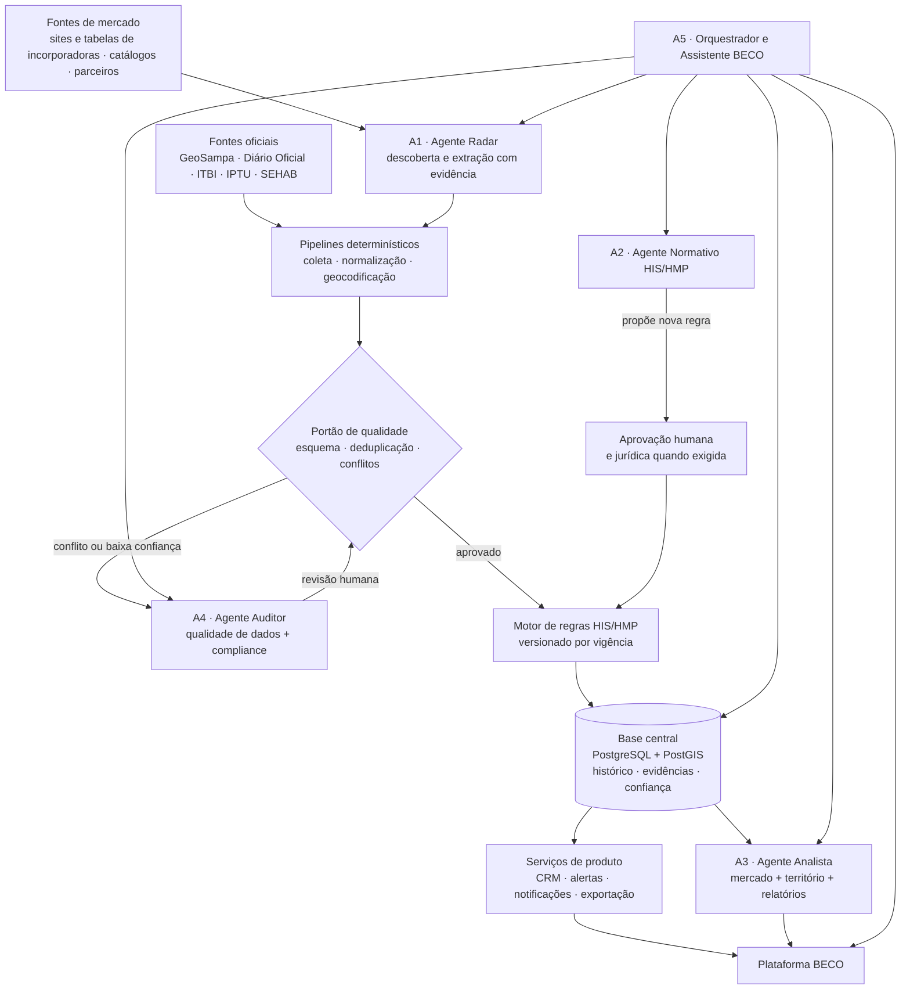

# BECO — Fase 0: Pesquisa, Benchmarking e Diagnóstico Estratégico

| Campo | Valor |
|---|---|
| Projeto | BECO (nome provisório) |
| Responsável | Diogo |
| Documento | Relatório da Fase 0 — primeira entrega |
| Versão | 0.1 (rascunho para validação) |
| Data | 21/11/2026 |
| Status | **Aguardando validação do responsável.** Nenhuma decisão irreversível foi tomada. |
| Anexos | [Fichas de concorrentes](BENCHMARK_FICHAS_CONCORRENTES.md) · [Fontes consultadas](FONTES_CONSULTADAS.md) · [Registro normativo HIS/HMP](../07_HIS_HMP_LEGAL/REGISTRO_NORMATIVO_HIS_HMP.yaml) · [Mapa de fontes de dados](../06_REAL_ESTATE_INTELLIGENCE/MAPA_FONTES_DE_DADOS.md) · [Análise do briefing do Radar](../06_REAL_ESTATE_INTELLIGENCE/ANALISE_BRIEFING_RADAR.md) · [Catálogo preliminar de skills](../10_SKILLS/CATALOGO_PRELIMINAR_SKILLS.md) · [Territórios de posicionamento](../02_BRAND_STRATEGY/TERRITORIOS_POSICIONAMENTO.md) · [Decisões pendentes](../00_PROJECT_MANAGEMENT/DECISOES_PENDENTES.md) |

## Como ler este documento

Cada afirmação factual traz uma etiqueta de confiabilidade e um código de fonte (`[F01]`, `[F02]`…) que remete ao [registro de fontes](FONTES_CONSULTADAS.md), com link e data de consulta.

| Etiqueta | Significado |
|---|---|
| **[O]** | Fonte oficial (Prefeitura, Câmara, Diário Oficial, Planalto, órgão público), lida a partir do trecho indexado pelo mecanismo de busca |
| **[S]** | Fonte secundária (imprensa, escritório de advocacia, blog setorial, material do próprio fornecedor) |
| **[D]** | Dado derivado: cálculo feito pelo BECO a partir de dados com fonte |
| **[H]** | Hipótese ou inferência da equipe, ainda sem comprovação |
| **[NC]** | Não confirmado ou conflitante entre fontes |

### Limitação de método (importante)

A rede do ambiente de trabalho bloqueou o acesso direto aos sites `prefeitura.sp.gov.br`, `gestaourbana.prefeitura.sp.gov.br`, `geosampa.prefeitura.sp.gov.br`, `registro.br` e outros. Toda a pesquisa desta fase foi feita por **mecanismo de busca indexada**, que devolve trechos das páginas, e não o texto integral. Consequências:

1. Valores legais (limites de renda e preço) foram conferidos em mais de uma fonte e por cálculo de consistência, mas **o texto integral dos decretos não foi lido**. Antes de qualquer uso operacional, o texto publicado no Diário Oficial da Cidade precisa ser conferido.
2. Funcionalidades de concorrentes vêm do que eles divulgam publicamente. Nenhum produto foi testado por dentro.
3. A disponibilidade do nome e do domínio BECO **não foi verificada** (o INPI e o registro.br não estavam acessíveis).

Para a Fase 4 em diante, recomenda-se liberar esses domínios na política de rede do ambiente (ver [Decisões pendentes](../00_PROJECT_MANAGEMENT/DECISOES_PENDENTES.md)).

### Mapa das 8 tarefas da primeira execução

| Tarefa do briefing | Onde está |
|---|---|
| T1 — Concorrentes e referências | §3, §4 e [fichas](BENCHMARK_FICHAS_CONCORRENTES.md) |
| T2 — Mercado HIS/HMP em São Paulo | §2 e §5, [registro normativo](../07_HIS_HMP_LEGAL/REGISTRO_NORMATIVO_HIS_HMP.yaml) |
| T3 — Briefing original do Radar | [Análise do briefing](../06_REAL_ESTATE_INTELLIGENCE/ANALISE_BRIEFING_RADAR.md) — **o anexo não foi encontrado no repositório** |
| T4 — Viabilidade de plataforma com agentes | §9 e §10 |
| T5 — Agentes, skills, ferramentas, APIs | §9, §10, [catálogo de skills](../10_SKILLS/CATALOGO_PRELIMINAR_SKILLS.md), [mapa de fontes](../06_REAL_ESTATE_INTELLIGENCE/MAPA_FONTES_DE_DADOS.md) |
| T6 — Diagnóstico estratégico | §1, §6 e §11 |
| T7 — Três territórios de posicionamento | §7 e [documento de territórios](../02_BRAND_STRATEGY/TERRITORIOS_POSICIONAMENTO.md) |
| T8 — Roadmap com custos, riscos e critérios | §12 |

---

## 1. Resumo executivo

**A oportunidade é real, mas é diferente da que o briefing descreve.** O briefing trata HIS/HMP como um "segmento de oportunidades" a ser monitorado. A pesquisa mostra que, em novembro de 2026, HIS/HMP em São Paulo é ao mesmo tempo **o maior volume de lançamentos da cidade** e **um mercado sob forte fiscalização**. A plataforma que vencer nesse espaço será a que oferecer **confiabilidade de enquadramento**, e não só volume de oportunidades.

Cinco fatos sustentam o diagnóstico:

1. **HIS domina os lançamentos.** A participação de HIS nos lançamentos da capital passou de 42% (2023) para cerca de 70% (2026), segundo dados apresentados na Convenção Secovi-SP 2026 [S][F30]. Em agosto de 2026, o segmento de baixa renda respondeu por 77% das 17,8 mil unidades lançadas no mês [S][F28].
2. **A fiscalização mudou de patamar.** O Decreto 64.244/2025 trocou a autodeclaração de renda por certidão emitida pelo Município e condicionou o Certificado de Conclusão à averbação das unidades HIS/HMP nas matrículas [O][F05][S][F07]. A SEHAB fiscaliza 264.799 unidades em 1.054 empreendimentos e as multas somam R$ 44,1 milhões (nota de 05/08/2026) [O][F12]. A Prefeitura pediu a Airbnb, QuintoAndar e Booking a retirada de anúncios de 60.922 unidades [O][F13].
3. **O poder público já publica a espinha dorsal dos dados.** O GeoSampa tem uma camada própria com os alvarás de execução de HIS-1, HIS-2 e HMP aprovados pela SMUL desde agosto de 2019, disponível para download (`HIS_HMP_Habitacao_Popular`) [O][F15]. A base do IPTU (mais de 3 milhões de registros) [O][F47] e as transações de ITBI desde 2019 [O][F48] também são abertas. O BECO pode partir de **fonte oficial**, e não de raspagem de anúncios.
4. **Ninguém ocupa a posição de "dado com procedência" para HIS/HMP.** Os incumbentes (DataZAP/Geoimovel, Brain, Apto, Órulo, DWV) monitoram lançamentos e preços, mas nenhum deles divulga verificação do enquadramento HIS por alvará, regra vigente e evidência [H, a validar com demonstrações]. Até o QuintoAndar, que investe R$ 2 bilhões em IA [S][F31], recebeu ofício para remover anúncios irregulares [O][F13].
5. **Há um risco central de produto.** Unidades HIS/HMP só podem ser vendidas ou alugadas a famílias dentro da faixa de renda, e a locação de curta temporada é proibida [O][F05][F16]. Um "radar de oportunidades HIS para investidores" facilitaria exatamente a prática que está sob investigação da CPI, do MP-SP e da SEHAB [O][F17][F19]. **O BECO precisa nascer com salvaguardas de elegibilidade**, sob pena de risco jurídico e reputacional.

**Recomendação estratégica (para validação):** posicionar o BECO como **a referência de procedência da informação imobiliária**, começando por HIS/HMP em São Paulo (Território 1 em §7). O radar de lançamentos vira a porta de entrada do produto, e o diferencial é que cada empreendimento e cada unidade trazem origem, data, regra aplicada e nível de confiança.

**Recomendação de arquitetura:** a imagem "Arquitetura inicial do BECO" propõe um orquestrador e 10 agentes. Recomendamos **5 agentes de IA** e mover as demais funções para **serviços determinísticos** (CRM, notificações, geoprocessamento, regras legais), com **portões de qualidade** obrigatórios antes de qualquer dado virar "fato" na plataforma (§9).

**Viabilidade:** técnica e financeiramente viável para um MVP. A estimativa preliminar é de **US$ 200 a 600 por mês** de infraestrutura e IA na primeira versão (§10), sem contar pessoas, validação jurídica e registro de marca.

**O que depende do Diogo agora** (detalhe em §13): definir o cliente primário, confirmar a postura sobre investidores em HIS, enviar o briefing original do Radar (não encontrado), aprovar o território de posicionamento e autorizar a busca formal de anterioridade do nome.

---

## 2. Diagnóstico de mercado

### 2.1 Tamanho e dinâmica do mercado de lançamentos em São Paulo

| Indicador | Valor | Etiqueta | Fonte |
|---|---|---|---|
| Unidades residenciais lançadas na capital em 12 meses até junho/2026 | 143,7 mil, 67% enquadradas no MCMV | [S] | [F29] |
| Unidades lançadas em agosto/2026 | 17,8 mil (+90% sobre ago/2025); 13,6 mil de baixa renda (77%) | [S] | [F28] |
| Participação de HIS nos lançamentos | 42% em 2023 → 70% em 2026 | [S] | [F30] |
| Tabela do relatório Secovi-SP de março/2026 | HIS 64%, HMP 9% (a unidade de medida da linha precisa ser conferida no PDF) | [NC] | [F27] |
| Médio e médio-alto padrão, 1º semestre/2026 | Lançamentos −28%; MCMV +31% | [S] | [F29] |
| Compactos (junho/2026) | 70% dos lançamentos; unidades < 30 m² = 17% | [S] | [F29] |
| Unidades HIS aprovadas (licenciamento SMUL) | 876.095 HIS e 171.531 HMP (valores de 24/08/2026; o período de referência precisa ser conferido) | [O] | [F14] |

**Leitura:** o mercado paulistano de lançamentos é, hoje, majoritariamente um mercado de HIS. Isso tem três implicações para o BECO:

- O recorte HIS/HMP **não é nicho**: é o centro do volume.
- Por ser o centro do volume, os incumbentes já cobrem lançamentos em geral. A diferenciação precisa vir da **qualidade do enquadramento**, não da cobertura.
- Há forte concentração em produtos compactos, o que reforça a necessidade de separar **HIS/HMP** de **studios de livre comercialização** (R2V/NR), como o briefing pede.

### 2.2 Ambiente regulatório e de fiscalização (2024–2026)

A linha do tempo abaixo resume as mudanças relevantes. O detalhe está em §5 e no [registro normativo](../07_HIS_HMP_LEGAL/REGISTRO_NORMATIVO_HIS_HMP.yaml).

| Data | Evento | Etiqueta | Fonte |
|---|---|---|---|
| 19/01/2024 | Lei 18.081/2024 (revisão parcial da LPUOS) e Decreto 63.130/2024 (regulamenta HIS/HMP) | [O] | [F11][F08] |
| 07/2024 | Lei 18.177/2024 ("revisão da revisão"); seu art. 8º, que alterou o mapa de zoneamento, foi depois declarado inconstitucional pelo TJ-SP | [O] | [F11] |
| 10/09/2024 | Decreto 63.728/2024 compatibiliza a legislação de HIS/HMP | [O] | [F09] |
| 01/2025 | Prefeitura multa construtoras em R$ 31 milhões após ação por fraude | [S] | [F19] |
| 28/05/2025 | Decreto 64.244/2025: certidão de renda municipal, averbação na matrícula, proibição de locação por temporada | [O][S] | [F05][F06][F07] |
| 2025 | MP-SP registra aumento de denúncias após cartórios passarem a comunicar indícios em matrículas | [S] | [F19] |
| 06/01/2026 | Decreto 64.895/2026 atualiza limites de renda e preço para 2026 | [O] | [F01][F03] |
| 03/2026 | Lista de cerca de 165 mil unidades em 490 empreendimentos apresentada à CPI | [S] | [F24] |
| 04/2026 | Prefeitura lança edital de plataforma digital de auditoria de imóveis populares | [S] | [F20] |
| 06/05/2026 | SEHAB pede retirada de anúncios de 60.922 unidades a Airbnb, QuintoAndar e Booking | [O] | [F13] |
| 05/2026 | MP-SP ajuíza ação civil pública; mais de 11 mil comunicações de cartórios desde março/2025 | [S] | [F19] |
| 19/05/2026 | CPI HIS aprova relatório final (mais de mil páginas), com encaminhamentos ao MP-SP, MPF e polícias | [O][S] | [F17][F18] |
| 06/2026 | Portaria Conjunta SMUL/SEHAB 01/2026: plataforma integrada de dados de licenciamento e fiscalização | [O] | [F14][F22] |
| 05/08/2026 | SEHAB: 264.799 unidades fiscalizadas, 1.054 empreendimentos, R$ 44,1 milhões em multas | [O] | [F12] |
| 10/2026 | Notícia de decisão judicial determinando sistema antifraude (uma única fonte secundária; não confirmada em segunda busca) | [NC] | [F21] |

**Leitura:** em dois anos, o regime de HIS/HMP passou de "autodeclaração e baixa fiscalização" para "certidão, averbação, cruzamento de dados e multa". Para quem vende, compra, financia ou anuncia HIS, **saber se uma unidade está corretamente enquadrada virou um problema de risco**, e não só de marketing. É esse o espaço que o BECO pode ocupar.

### 2.3 Quem sente a dor (segmentos candidatos)

| Segmento | Dor principal | Disposição a pagar | Etiqueta |
|---|---|---|---|
| Incorporadoras de HIS/HMP | Conformidade (certidões, averbações, preço-teto, multas), inteligência competitiva sobre lançamentos e terrenos | Alta | [H] |
| Imobiliárias e corretores de lançamentos | Saber o que está disponível, para quem pode ser vendido e com qual preço máximo; evitar vender a comprador inelegível | Média | [H] |
| Portais e marketplaces | Evitar anúncios irregulares (caso SEHAB × plataformas) | Média a alta, via API | [H] |
| Bancos, correspondentes e securitizadoras | Verificar enquadramento e preço-teto antes do crédito | Alta | [H] |
| Investidores | Studios de livre comercialização (R2V/NR) e terrenos. **Não HIS para uso próprio de investimento.** | Média | [H] |
| Poder público, pesquisadores, imprensa | Transparência e monitoramento | Baixa (possíveis parcerias e visibilidade) | [H] |
| Famílias elegíveis | Encontrar unidades compatíveis com a própria faixa de renda | Baixa direta; alto valor social | [H] |

Todos esses segmentos são hipóteses. A escolha do **cliente primário** é a decisão mais importante desta fase (§13).

---

## 3. Benchmarking competitivo

As fichas completas, com os 17 critérios pedidos no briefing, estão em [BENCHMARK_FICHAS_CONCORRENTES.md](BENCHMARK_FICHAS_CONCORRENTES.md). Aqui fica a síntese.

### 3.1 Quadro comparativo

| Player | Categoria | Público | O que faz (divulgado) | HIS/HMP com verificação? | IA divulgada | Fonte |
|---|---|---|---|---|---|---|
| **QuintoAndar** | Marketplace + B2B | Consumidor; imobiliárias | Busca com IA generativa, app no ChatGPT (mar/2026), QPreço, QuintoAndar for Business com Domi (IA de atendimento) e Univen (CRM); R$ 2 bi em IA em 2 anos | Não divulgado; recebeu ofício da SEHAB para remover anúncios | Sim, central na estratégia | [S][F31], [O][F13] |
| **Loft** | Marketplace + SaaS | Imobiliárias | Loft/CRM (ex-Vista, 9.000+ imobiliárias; plano de entrada R$ 129,90/mês até 30 usuários), Loft/Dados (benefício do Clube Loft), entrada em incorporadoras; agentes de IA anunciados para 2026 | Não divulgado | Sim (anunciada) | [S][F32] |
| **DataZAP** (OLX Brasil) | Inteligência de mercado | Incorporadoras, bancos | Estudos, AVM (Quanto Vale) integrado à Gestão de Garantias da B3, módulo Geoimovel de lançamentos | Não divulgado | AVM / modelos | [S][F33] |
| **Geoimovel** | Monitoramento de lançamentos | Incorporadoras | Desde 2001; base de ~3 milhões de unidades lançadas em 500+ cidades; hoje integrada ao DataZAP | Não divulgado | Não divulgado | [S][F35] |
| **FipeZAP** | Índice de preços | Mercado em geral | Índice de preços de anúncios em 56 cidades | Não se aplica (preço pedido) | Não | [S][F34] |
| **Brain** | Pesquisa e consultoria | Incorporadoras, entidades | Pesquisas nacionais (com ABRAINC e CBIC), Geobrain (georreferenciamento de empreendimentos) | Não divulgado | Não divulgado | [S][F36] |
| **Órulo** | Marketplace B2B de imóveis novos | Imobiliárias e incorporadoras | Incorporadoras publicam; imobiliárias acessam gratuitamente; integração com CRMs | Não divulgado | Não divulgado | [S][F37] |
| **Apto** | Portal de imóveis novos | Compradores; incorporadoras | Monitoramento de mercado: painel de lançamentos com filtros por bairro, empreendimento e incorporadora, mapa com metrô e trem (incluindo linhas futuras), atualização semanal | Não divulgado | Não divulgado | [S][F38] |
| **DWV** | Plataforma de negócios | Corretores e incorporadoras | Conecta quem tem o produto a quem vende; lançamentos, estoque e desempenho comercial | Não divulgado | Não divulgado | [S][F39] |
| **Place** | Viabilidade de terrenos | Incorporadoras | Viabilidade financeira e volumétrica em SP; parceria ABRAINC (jun/2024) | Não se aplica | Não divulgado | [S][F40] |
| **CV CRM / Anapro / Sienge** | CRM e ERP | Incorporadoras | Gestão comercial, espelho de vendas, portal do corretor; CV Magic (IA) | Não divulgado | CV Magic | [S][F38][F41] |
| **CoStar + Zonda** (EUA) | Dados de lançamentos | Construtoras, credores | Zonda: base por lote de comunidades novas, status de obra, operação de construtoras; IA (Enterprise Accelerator). Comprada pela CoStar por US$ 800 mi (anúncio em 29/05/2026) | Não se aplica | Sim | [S][F42] |
| **Regrid / Zoneomics / Gridics** (EUA) | Lotes e zoneamento | Desenvolvedores, investidores | Zoneamento padronizado por lote via API (Regrid: 6.000+ municípios) | Não se aplica | Parcial | [S][F43][F44] |
| **Archistar / PropStream** | Viabilidade e dados de investidor | Desenvolvedores, investidores | Viabilidade com IA (Austrália); dados de imóveis com busca conversacional (EUA, US$ 99 a 699/mês) | Não se aplica | Sim | [S][F45] |
| **ExactEstate / AppFolio / Fortress** (EUA) | Conformidade de habitação acessível (LIHTC) | Gestores de habitação acessível | Certificação de renda, recertificação e relatórios regulatórios | **Análogo direto** ao problema de HIS | Parcial | [S][F46] |

### 3.2 Padrões identificados

1. **Os incumbentes brasileiros cobrem lançamentos e preços, não enquadramento legal.** Nenhum material público encontrado descreve verificação de HIS/HMP por alvará e regra vigente [H].
2. **A IA no setor está concentrada em atendimento e busca** (QuintoAndar, Loft, CV Magic), e não em procedência e verificação.
3. **O mercado americano mostra o valor de dados de lançamentos por lote.** A compra da Zonda pela CoStar por US$ 800 milhões [S][F42] indica que dados granulares de construção nova são um ativo estratégico.
4. **A conformidade de habitação acessível é uma categoria de software nos EUA** (LIHTC) [S][F46]. No Brasil, não encontramos equivalente para HIS/HMP [H]. É o achado mais promissor da pesquisa.
5. **Zoneamento por lote via API** (Regrid, Zoneomics, Gridics) não tem equivalente comercial conhecido para São Paulo. O GeoSampa é a fonte, mas é técnico e não orientado a mercado [H].

### 3.3 Concorrentes especializados em HIS/HMP

Não encontramos um portal ou plataforma dedicada a HIS/HMP com verificação de enquadramento [S][F16][F25]. Existem:

- guias e simuladores de faixa de renda em sites de corretores, escritórios e incorporadoras [S][F25];
- a lista oficial da SEHAB de empreendimentos com HIS disponíveis e a camada do GeoSampa [O][F15][F16];
- a futura plataforma de auditoria da Prefeitura, voltada à fiscalização e não ao mercado, sem confirmação de que já esteja no ar [S][F20].

A plataforma da Prefeitura é ao mesmo tempo **um risco** (o poder público passa a ter a ferramenta de verificação) e **uma oportunidade** (ela tende a gerar dados públicos e a pressionar o mercado por conformidade).

---

## 4. Benchmarking de identidade e experiência

**Limitação:** sem acesso às páginas, esta análise de identidade visual é **qualitativa e por categoria**, não uma auditoria de cada marca. Na Fase 1, ela será refeita com capturas de tela, paletas e tipografias registradas.

### 4.1 Padrões visuais saturados (evitar)

| Categoria | Padrão saturado | Por que evitar |
|---|---|---|
| Proptech | Telhado de casa, pin de localização, chave, porta | Lido como "mais um portal"; não comunica inteligência |
| Dados e fintech | Azul-confiança, gradiente azul-violeta, gráficos de barras dentro do símbolo | Indistinguível de bancos digitais e SaaS genéricos |
| IA | Faíscas (✨), cérebros, redes neurais, tipografia futurista | Data o produto rapidamente; reforça a "estética genérica de IA" que o briefing proíbe |
| Geointeligência | Globo, mira, curvas de nível genéricas | Associação com defesa e logística, não com cidade e mercado |
| Mercado imobiliário tradicional | Dourado, serifas clássicas, fotos de fachada aspiracional | Distância do público de HIS; conotação de luxo |

### 4.2 Territórios visuais pouco explorados (hipóteses para a Fase 1)

1. **Linguagem cadastral paulistana.** Quadras, lotes, o código setor-quadra-lote do IPTU, o traçado das ruas, plantas de loteamento. É informação pública e é exatamente a matéria-prima do BECO.
2. **Linguagem documental de procedência.** Matrícula, protocolo, carimbo, selo, número de alvará. Comunica rastreabilidade sem recorrer a clichês de tecnologia.
3. **O "beco" como passagem.** Um beco é o caminho estreito entre quadras, o atalho que quem conhece a cidade usa. Pode virar um sistema gráfico de "passagens" entre blocos de informação, sem desenhar casas nem pins.
4. **Materiais urbanos como paleta.** Concreto, asfalto, sinalização viária, vegetação de praça, em vez do azul e violeta de tecnologia.

Esses são caminhos de pesquisa, não decisões. A Fase 1 vai desenvolvê-los e compará-los.

### 4.3 Referências de experiência (UX)

| Referência | O que aprender | O que não copiar | Etiqueta |
|---|---|---|---|
| QuintoAndar | Busca como ponto de partida; filtros progressivos; alternância lista/mapa; atendimento por IA integrado ao funil | Telas, componentes, identidade | [S][F31] + observação de uso público [H] |
| Apto | Mapa de lançamentos com transporte, incluindo linhas futuras | Layout | [S][F38] |
| GeoSampa | Riqueza de camadas oficiais | A complexidade de interface (é ferramenta técnica) | [O][F49] |
| Zonda / CoStar | Dado por lote, status de obra, histórico | Densidade de painel corporativo | [S][F42] |
| LIHTC compliance (ExactEstate, AppFolio) | Dossiê por unidade, recertificação, trilha de auditoria | Complexidade de software de gestão predial | [S][F46] |

**Princípios de experiência propostos para a Fase 3 [H]:**

- **Procedência visível:** todo número na tela mostra de onde veio, quando foi verificado e com que confiança, em um toque.
- **Estado explícito:** "confirmado", "não confirmado" e "conflitante" são estados visuais de primeira classe, não notas de rodapé.
- **Regra no contexto:** ao ver uma unidade HIS-2, o usuário vê a faixa de renda e o preço-teto vigentes na data, com a norma de origem.
- **Mapa como ferramenta, não decoração:** o mapa responde a perguntas (o que foi licenciado perto daqui? onde há ZEIS?), e não serve só de vitrine.

---

## 5. Estudo de HIS/HMP em São Paulo

O registro estruturado, com os campos exigidos pelo briefing (identificação, fonte oficial, publicação, vigência, abrangência, interpretação operacional, impacto na classificação e data de verificação), está em [REGISTRO_NORMATIVO_HIS_HMP.yaml](../07_HIS_HMP_LEGAL/REGISTRO_NORMATIVO_HIS_HMP.yaml).

> **Aviso:** este estudo é inteligência de mercado, não parecer jurídico. Os pontos marcados como "validação jurídica" precisam de revisão por advogado especializado em direito urbanístico antes de virar regra no sistema.

### 5.1 Arcabouço normativo

| Norma | Papel | Status | Etiqueta |
|---|---|---|---|
| Lei 16.050/2014 (Plano Diretor Estratégico) | Define HIS-1, HIS-2 e HMP e as faixas de renda (art. 46) | Vigente, com revisão intermediária | [O][F01][F10] |
| Lei 17.975/2023 | Revisão intermediária do PDE (cerca de 120 artigos de ajuste) | Vigente | [O][F10] |
| Lei 16.402/2016 (LPUOS) | Parcelamento, uso e ocupação do solo; ZEIS | Vigente, com revisões | [O][F11] |
| Lei 18.081/2024 | Revisão parcial da LPUOS (19/01/2024); declarada constitucional | Vigente | [O][F11] |
| Lei 18.177/2024 | Ajustes à 18.081; art. 8º (mapa) declarado inconstitucional | Parcialmente vigente — validação jurídica | [O][F11] |
| Decreto 63.130/2024 | Regulamenta a produção privada de HIS/HMP | Vigente, alterado pelo 64.244/2025 | [O][F05][F08] |
| Decreto 63.728/2024 | Compatibiliza a legislação de HIS/HMP | Vigente (relação com o 63.130 a confirmar) | [O][F09] |
| Decreto 64.244/2025 | Endurece controle: certidão de renda, averbação, locação | Vigente | [O][F05][F06] |
| Decreto 64.006/2025 | Valores de 2025 | **Revogado** pelo 64.895/2026 | [S][F03] |
| Decreto 64.895/2026 | Valores de 2026 (renda e preço) | Vigente em 2026 | [O][F01][F03] |
| Portaria Conjunta SMUL/SEHAB 01/2026 | Compartilhamento de dados de licenciamento e fiscalização | Vigente desde jun/2026 | [O][F14][S][F22] |
| Decreto federal 12.797/2025 | Salário mínimo de 2026: R$ 1.621 | Vigente | [O][F04] |

### 5.2 Parâmetros vigentes em 2026

**Faixas de renda.** O PDE define as faixas em salários mínimos (SM). Com o SM de 2026 de R$ 1.621 [O][F04], a Prefeitura divulgou [O][F01][F02]:

| Categoria | Regra do PDE | Renda familiar mensal máxima (2026) | Renda per capita máxima (2026) |
|---|---|---|---|
| HIS-1 | até 3 SM ou 0,5 SM per capita | R$ 4.863,00 | R$ 810,50 |
| HIS-2 | até 6 SM ou 1 SM per capita | R$ 9.726,00 | R$ 1.621,00 |
| HMP | até 10 SM ou 1,5 SM per capita | R$ 16.210,00 | R$ 2.431,50 |

Conferência [D]: 3 × 1.621 = 4.863; 6 × 1.621 = 9.726; 10 × 1.621 = 16.210; 0,5 × 1.621 = 810,50; 1,5 × 1.621 = 2.431,50. Os valores divulgados são consistentes com a regra.

**Preço máximo de venda.** O Decreto 64.895/2026 corrigiu os tetos pelo INCC de maio a dezembro de 2025 [O][F01][F03]:

| Categoria | Teto 2025 (Decreto 64.006/2025) | Teto 2026 (Decreto 64.895/2026) | Variação [D] |
|---|---|---|---|
| HIS-1 | R$ 266.000,00 | R$ 276.102,20 | +3,80% |
| HIS-2 | R$ 369.600,00 | R$ 383.636,74 | +3,80% |
| HMP | R$ 518.000,00 | R$ 537.672,71 | +3,80% |

Conferência [D]: as três razões (276.102,20 / 266.000; 383.636,74 / 369.600; 537.672,71 / 518.000) dão o mesmo fator, ≈ 1,03798, como se espera de uma correção única pelo INCC.

**Aluguel máximo.** O aluguel não pode passar de 30% da renda familiar máxima da faixa [O][F05][S][F07]. Cálculo derivado [D], a confirmar no texto do decreto:

| Categoria | Aluguel máximo mensal estimado (2026) |
|---|---|
| HIS-1 | R$ 1.458,90 |
| HIS-2 | R$ 2.917,80 |
| HMP | R$ 4.863,00 |

**Atualização em janeiro de 2027.** Os limites de renda mudam com o novo salário mínimo, normalmente decretado no fim de dezembro, e os tetos de preço com o INCC [O][F03]. **Este é o primeiro teste real do mecanismo de atualização normativa do BECO**: a plataforma precisa aplicar a regra vigente na data de cada transação, e não a regra de hoje.

### 5.3 Regras de comercialização e uso

| Regra | Conteúdo | Etiqueta | Fonte |
|---|---|---|---|
| Destinação | Venda ou locação apenas a famílias na faixa de renda correspondente | [O] | [F05][F16] |
| Comprovação de renda | Por certidão emitida pelo Município, e não por autodeclaração | [O][S] | [F05][F07] |
| Momento da comprovação | Na assinatura do compromisso de compra e venda ou do contrato definitivo | [S] | [F07] |
| Conceito de família | Conceito ampliado da Lei federal 13.982/2020 | [S] | [F07] |
| Averbação | O Certificado de Conclusão (habite-se) depende da averbação do enquadramento nas matrículas das unidades | [O][S] | [F05][F07] |
| Locação por temporada | Proibida (prazos inferiores a 90 dias); vedação permanente, que não depende do prazo de restrição | [O] | [F12][F16] |
| Prazo de restrição | Restrição de 10 anos citada por fontes secundárias | [S] — validação jurídica | [F25] |
| Fiscalização | SEHAB e Subprefeituras podem requisitar comprovantes de renda, contratos, contas de consumo e outros documentos | [S] | [F07] |
| Multas | Calculadas pela SMUL/PARHIS sobre os incentivos concedidos a unidades sem destinação correta | [O] | [F14] |
| Unidades de livre comercialização | Empreendimentos podem ter unidades fora da faixa (R2V, NR, "ULC") | [S] | [F25] |

### 5.4 Classificação: empreendimento × unidade

O briefing pede, com razão, que não se confunda a classificação do empreendimento com a de cada unidade. A pesquisa confirma a importância disso:

- Um **EHIS** ou **EHMP** é um empreendimento que destina unidades a HIS ou HMP, mas pode conter unidades de outras categorias. Um **EZEIS** é um empreendimento em ZEIS, sujeito a percentuais mínimos por tipo de ZEIS. **Os percentuais exatos (Quadro 4 do PDE, com redação da Lei 17.975/2023) ainda precisam ser extraídos do texto da lei** [H — validação jurídica].
- A camada do GeoSampa informa as unidades HIS-1, HIS-2 e HMP **por alvará** [O][F15]. Ela não identifica qual unidade (apartamento 101, 102…) é de qual categoria.
- A identificação por unidade passa a existir na **matrícula**, por causa da averbação exigida pelo Decreto 64.244/2025 [O][F05]. A consulta de matrículas é paga e feita via Registro de Imóveis.

**Taxonomia proposta para o BECO [H]:**

| Nível | Categorias | Evidência mínima para "confirmado" |
|---|---|---|
| Empreendimento | EHIS, EHMP, EZEIS, misto (HIS + HMP + livre), residencial convencional, não residencial, hoteleiro | Alvará (GeoSampa/SMUL) ou memorial de incorporação |
| Unidade | HIS-1, HIS-2, HMP, R2V (livre comercialização), NR, studio residencial livre, comercial, hoteleira | Averbação em matrícula ou tabela oficial da incorporadora conciliada com o alvará |
| Qualquer nível sem evidência | **"Classificação não confirmada"** | — |

### 5.5 Fontes de dados para HIS/HMP

| Fonte | O que fornece | Acesso | Etiqueta |
|---|---|---|---|
| GeoSampa — camada "HIS e HMP – Alvará de Execução" | Alvarás de HIS-1, HIS-2 e HMP aprovados pela SMUL desde ago/2019, com unidades por categoria | Download aberto | [O][F15] |
| SEHAB — lista de empreendimentos com HIS disponíveis | Empreendimentos com unidades à venda | Página pública | [O][F16] |
| Diário Oficial da Cidade | Decretos, portarias, despachos de multa | Público | [O] |
| ITBI (Secretaria da Fazenda) | Transações imobiliárias desde 2019, atualização mensal (Lei 18.161/2024) | Download aberto | [O][F48] |
| IPTU (cadastro fiscal) | Mais de 3 milhões de registros, características dos imóveis | Download aberto (GeoSampa) | [O][F47] |
| Matrículas (Registro de Imóveis) | Averbação do enquadramento por unidade | Pago, por certidão | [H] |
| Sites e tabelas de incorporadoras | Preço, tipologia, disponibilidade comercial | Público, sujeito a termos de uso | [H] |

**Ideia de alto valor, a validar juridicamente [H]:** cruzar o valor declarado no ITBI das unidades de empreendimentos HIS com o preço-teto vigente na data da transação. Isso gera um **indicador de aderência ao teto por empreendimento**, sem expor dados pessoais. Antes de implementar, é preciso confirmar quais campos a base do ITBI traz e fazer uma avaliação de impacto de LGPD.

### 5.6 Mecanismo de atualização normativa (proposta)

1. **Monitorar** diariamente o Diário Oficial da Cidade, as páginas da SMUL, SEHAB e Gestão Urbana e a Câmara Municipal, com filtros por palavras-chave (HIS, HMP, EHIS, ZEIS, "habitação de interesse social", números de decretos conhecidos).
2. **Triar** com IA: o agente normativo resume a mudança e indica quais regras do registro ela afeta.
3. **Propor** a alteração da regra no registro, com nova vigência, sem apagar a versão anterior.
4. **Aprovar** com revisão humana obrigatória (e jurídica, quando marcada).
5. **Recalcular** as classificações afetadas e notificar os usuários que acompanham os empreendimentos atingidos.

Cada regra tem `vigencia_inicio` e `vigencia_fim`; uma transação é sempre avaliada pela regra vigente **na sua data**.

---

## 6. Oportunidade de negócio

### 6.1 Matriz de oportunidades

Complexidade e potencial de monetização são avaliações preliminares da equipe [H].

| # | Problema no mercado | Como é resolvido hoje | Limitações | Oportunidade para o BECO | Diferencial proposto | Complexidade técnica | Potencial de monetização |
|---|---|---|---|---|---|---|---|
| 1 | Classificação HIS/HMP de lançamentos não é confiável | O anunciante informa; portais republicam | Sem conferência com alvará; SEHAB pediu remoção de 60.922 anúncios [O][F13] | Classificação verificada por alvará, regra vigente e evidência | "Selo de procedência" por empreendimento e por unidade | Média-alta | **Alta** (incorporadoras, imobiliárias, portais via API) |
| 2 | Lançamentos só são detectados quando chegam ao mercado | Geoimovel, Brain e Apto monitoram lançamentos comerciais | Detecção tardia | Detectar no licenciamento: alvarás HIS/HMP no GeoSampa aparecem antes do lançamento [O][F15][H] | Pipeline futuro por bairro e por incorporadora | Média | **Alta** (incorporadoras, terrenistas, fornecedores) |
| 3 | Conformidade HIS virou risco para incorporadoras | Assessoria jurídica e planilhas internas [H] | Sem controle por unidade de certidão, averbação e preço-teto | Módulo de conformidade: dossiê por unidade, prazos, checagem de preço e renda vigentes | Regras versionadas por data; trilha de auditoria | **Alta** (envolve dados pessoais de compradores) | **Alta** |
| 4 | Mudanças normativas são difíceis de acompanhar | Advogados, boletins, notícias | Dispersas; sem impacto calculado | Monitor normativo com impacto por empreendimento | "O que mudou e quem foi afetado" | Média | Média |
| 5 | Preço anunciado ≠ preço praticado | FipeZAP (anúncios), AVM do DataZAP | Preço pedido; sem relação com o teto legal | ITBI × teto legal por data | Indicador de aderência ao teto | Média | Média-alta (bancos, fundos, poder público) |
| 6 | Inteligência territorial é técnica e cara | GeoSampa (técnico), Place, Geobrain | Interface técnica ou produto caro | Camadas curadas por empreendimento: ZEIS, eixos, transporte, HIS licenciado no entorno | Mapa que responde perguntas | Média | Média |
| 7 | Corretor não sabe que unidade cabe na renda de qual cliente | CRMs e espelhos de venda das incorporadoras | Fragmentado; sem cruzamento renda × faixa × preço | Calculadora de elegibilidade e unidades compatíveis | Prevenção de venda irregular | Média | Média (B2B2C) |
| 8 | Incorporadoras operam por SPEs e marcas diferentes | Acompanhamento manual | Difícil ligar CNPJ, SPE e marca | Resolução de entidades e histórico por grupo econômico | Ficha consolidada por incorporadora | Média | Média |
| 9 | IA do setor responde sem citar a fonte | Busca e atendimento com IA (QuintoAndar, CV Magic) | Foco em conversão, não em verificação | Assistente que sempre cita fonte, data e confiança | Confiabilidade como produto | Média | Diferencial (não é produto isolado) |
| 10 | Investidor de studios precisa separar livre comercialização de HIS | Portais | Mistura de categorias | Segmento próprio de studios R2V/NR, com regras de uso explícitas | Separação clara de categorias | Baixa-média | Média |

### 6.2 Modelos de negócio a testar [H]

| Modelo | Para quem | Comentário |
|---|---|---|
| Assinatura SaaS em camadas | Corretores e imobiliárias (entrada), incorporadoras (completa) | Referência de preço de entrada no mercado: Loft/CRM a R$ 129,90/mês até 30 usuários [S][F32] |
| API de verificação de enquadramento | Portais, bancos, correspondentes | Cobrança por consulta |
| Relatórios e estudos | Incorporadoras, fundos | Receita complementar, ajuda a construir autoridade |
| Licenciamento de dados | Grandes players | Só depois de base própria consolidada |

Não temos dados de preço dos incumbentes (DataZAP, Brain, Apto) para comparar. Isso precisa ser levantado com demonstrações comerciais na Fase 3.

---

## 7. Posicionamento proposto

O detalhamento dos três territórios, com a análise preliminar do nome, está em [TERRITORIOS_POSICIONAMENTO.md](../02_BRAND_STRATEGY/TERRITORIOS_POSICIONAMENTO.md). Síntese:

| Território | Ideia central | Público principal | Força | Fraqueza |
|---|---|---|---|---|
| **1. Procedência** | "Informação imobiliária com origem, data e confiança." O BECO como a fonte confiável de HIS/HMP | Incorporadoras, imobiliárias, bancos, portais | Responde à onda de fiscalização; ninguém ocupa; difícil de copiar (exige método) | Menos "emocionante"; precisa de rigor real para não virar promessa vazia |
| **2. Antecipação** | "Veja o mercado antes dele aparecer." Radar que detecta lançamentos no licenciamento | Incorporadoras, corretores, investidores de studios | Valor imediato e tangível | Incumbentes já falam de monitoramento; diferenciação mais frágil |
| **3. Cidade legível** | "As regras da cidade, em linguagem clara." Tornar HIS/HMP e o território compreensíveis | Famílias elegíveis, corretores, imprensa, poder público | Valor social; potencial de marca forte | Monetização difícil; exige investimento em comunicação B2C |

**Recomendação:** **Território 1 (Procedência)** como posicionamento de marca, com o **Território 2 (Antecipação)** como principal funcionalidade de entrada no produto. O Território 3 pode virar conteúdo e produto gratuito de aquisição (calculadora de faixa, guia de regras), sem ser o posicionamento central.

**Sobre o nome BECO (análise preliminar, sem decisão):**

- **A favor:** curto, brasileiro, urbano, fácil de pronunciar; a ideia de "passagem que quem conhece a cidade usa" tem relação com inteligência territorial.
- **Contra:** a expressão "beco sem saída" é uma conotação negativa forte para um produto de oportunidades; "beco" também remete a lugares específicos (como o Beco do Batman, em São Paulo); por ser palavra comum, tende a ter muitas marcas coexistentes.
- **Possível conflito:** existe uma construtora e incorporadora chamada **Beco Castelo**, com projetos em Campinas e Florianópolis [S][F38]. Como atua no mesmo setor, é um ponto de atenção para a busca de anterioridade nas classes relacionadas a serviços imobiliários.
- **Próximo passo:** busca formal no INPI nas classes de Nice pertinentes (a definir na Fase 1, provavelmente 9, 35, 36 e 42) e verificação de domínios. Nenhuma das duas foi possível nesta fase.

---

## 8. Arquitetura preliminar do produto

### 8.1 Módulos e prioridade

| Módulo | Função | Prioridade no MVP [H] |
|---|---|---|
| Conta, perfis e permissões | Login, recuperação de acesso, perfis por tipo de cliente | MVP |
| Radar de empreendimentos | Novos alvarás e lançamentos, alterações, filtros por região, categoria e incorporadora | **MVP (núcleo)** |
| Ficha do empreendimento | Dados, classificação, evidências, histórico, mapa do entorno | **MVP (núcleo)** |
| Ficha da unidade | Tipologia, área, preço, preço por m², categoria, disponibilidade (confirmada ou não) | MVP (quando houver dado) |
| Mapa interativo | Empreendimentos, ZEIS, transporte, HIS licenciado no entorno | MVP |
| Incorporadoras | Ficha consolidada por grupo econômico | MVP simples |
| Favoritos, listas e alertas | Acompanhar empreendimentos e receber alterações | MVP |
| Central de notificações | Novidades, alterações, alertas regulatórios | MVP (e-mail e aplicativo) |
| Calculadora de elegibilidade | Faixa por renda e unidades compatíveis | MVP (gratuita, sem guardar renda) |
| Monitor normativo | Mudanças de regra e impacto | v1.1 |
| CRM de oportunidades | Contatos, atividades, status, observações | v1.1 |
| Relatórios | Boletim diário, relatórios por região e incorporadora | v1.1 |
| Assistente de IA | Perguntas em linguagem natural, sempre com fonte | v1.1 |
| Módulo de conformidade para incorporadoras | Dossiê por unidade, certidões, averbações | v2 (exige avaliação de LGPD) |
| API de verificação | Consulta de enquadramento por terceiros | v2 |

### 8.2 Jornada principal (rascunho)

1. O usuário entra, escolhe seu perfil (corretor, imobiliária, incorporadora…) e define preferências: regiões, categorias, faixas de preço, incorporadoras.
2. Recebe o boletim diário às 8h com novos alvarás, novos lançamentos e alterações, separados por relevância e confiança.
3. Abre a ficha do empreendimento: vê a classificação com o selo de procedência, o histórico e o mapa do entorno.
4. Salva nos favoritos, cria um alerta de alteração ou registra uma oportunidade no CRM.
5. Quando o dado muda (preço, disponibilidade, nova regra), recebe a notificação com o que mudou e a fonte.

As jornadas detalhadas, o sitemap, os wireframes e os protótipos são entregáveis da Fase 3.

---

## 9. Arquitetura preliminar de agentes e skills

### 9.1 Avaliação da arquitetura inicial

A imagem de referência ([referencia_arquitetura_inicial_briefing.jpg](../09_AI_AGENTS/referencia_arquitetura_inicial_briefing.jpg)) propõe: Orquestrador → 10 agentes em paralelo → Base central → Plataforma. Pontos fortes e problemas:

| Aspecto | Avaliação |
|---|---|
| Orquestrador central | Correto. Mantido. |
| Base central com rastreabilidade | Correto e essencial. Mantida. |
| Data Quality e Compliance como agentes pares dos demais | **Problema.** Desenhados lado a lado, não impedem que dados não verificados cheguem à base. Precisam ser **portões obrigatórios** no fluxo, reforçados por validação determinística (esquema, restrições no banco), e não só por um agente de IA. |
| Notificações e CRM como agentes de IA | **Desnecessário.** São serviços de produto determinísticos. A IA só entra para redigir resumos. |
| Radar imobiliário e Monitor de incorporadoras | **Sobreposição.** Os dois descobrem empreendimentos a partir das incorporadoras. Devem ser um só agente com skills por tipo de fonte. |
| Inteligência territorial | Majoritariamente **geoprocessamento determinístico** (consultas espaciais). A IA interpreta e explica. |
| Relatórios e insights | É uma etapa de geração, que pode ser uma skill do analista. |

### 9.2 Arquitetura proposta: 5 agentes de IA + serviços determinísticos + portões

| Agente | Responsabilidade | Funções do briefing que absorve | Por que precisa de IA |
|---|---|---|---|
| **A5 · Orquestrador e Assistente** | Recebe solicitações, distribui tarefas, consolida, aplica limites de custo, pede aprovação humana, responde ao usuário sempre com fonte | BECO Orchestrator | Interpretar pedidos em linguagem natural e planejar |
| **A1 · Radar** | Descobre empreendimentos e extrai dados estruturados de páginas, tabelas e PDFs, sempre anexando a evidência (trecho, URL, data, captura) | 01 Radar, 05 Monitor de incorporadoras | Fontes heterogêneas e não estruturadas |
| **A2 · Normativo HIS/HMP** | Lê publicações oficiais, identifica mudanças, propõe alterações de regra e classifica casos ambíguos | 02 Especialista HIS/HMP | Interpretação de texto legal (com revisão humana) |
| **A3 · Analista** | Responde perguntas de mercado e território, gera boletins e relatórios a partir da base | 03 Territorial, 04 Mercado, 08 Relatórios | Síntese e narrativa; os números vêm de consultas determinísticas |
| **A4 · Auditor** | Analisa conflitos entre fontes, dados desatualizados, fontes duvidosas, riscos de LGPD e permissões | 06 Data Quality, 10 Compliance | Julgamento em casos que as regras automáticas não resolvem |
| *Serviço* · CRM | Oportunidades, contatos, atividades, histórico | 07 CRM | Não precisa (A3 pode resumir) |
| *Serviço* · Notificações | Preferências, filas, envio, registro de entrega | 09 Notificações | Não precisa (A3 redige o boletim) |
| *Serviço* · Geoprocessamento | Consultas espaciais, camadas, entorno | parte do 03 | Não precisa |
| *Serviço* · Motor de regras | Enquadramento por renda, preço e data | parte do 02 | **Não deve** usar IA: regra legal numérica precisa ser determinística e auditável |

### 9.3 Orquestração

**Sequência obrigatória** (do briefing, com ajustes): Coleta (A1 + pipelines) → **Portão de qualidade** → Classificação (motor de regras) → [Territorial e Mercado **em paralelo**] → **Portão de compliance** → Publicação na base → Relatórios (A3) → Notificações (serviço).

**Regras do orquestrador:**

1. Nenhum dado vira "confirmado" sem evidência registrada. Sem evidência, o estado é "não confirmado", e a interface mostra isso.
2. Disponibilidade de unidade nunca é comunicada sem confirmação da fonte comercial.
3. Toda execução de agente fica registrada: entrada, ferramentas usadas, custo, resultado e quem aprovou.
4. Limite de custo por execução e por dia, com alerta.
5. Ações sensíveis (mudar regra, enviar comunicação em massa, exportar dados) exigem aprovação humana.

### 9.4 Skills

O briefing lista 20 skills. A pesquisa indica que faltam pelo menos 10, principalmente ligadas às fontes oficiais. O catálogo completo, com os campos exigidos (objetivo, agentes autorizados, entradas, saídas, ferramentas, validações, erros), está em [CATALOGO_PRELIMINAR_SKILLS.md](../10_SKILLS/CATALOGO_PRELIMINAR_SKILLS.md). Skills novas propostas:

| # | Skill | Por que é necessária |
|---|---|---|
| 21 | Geocodificação e normalização de endereços (CEP, código setor-quadra-lote) | Chave de deduplicação e cruzamento com IPTU e GeoSampa |
| 22 | Monitor do Diário Oficial da Cidade | Base do mecanismo de atualização normativa |
| 23 | Consulta a camadas do GeoSampa | Alvarás HIS/HMP, zoneamento, ZEIS, lotes |
| 24 | Cruzamento ITBI × teto legal | Indicador de aderência ao teto |
| 25 | Resolução de entidades (marca ↔ incorporadora ↔ SPE ↔ CNPJ) | Incorporadoras operam por SPE |
| 26 | Leitura de memorial de incorporação e matrícula | Classificação por unidade |
| 27 | Cálculo de enquadramento por data | Regra vigente na data da transação |
| 28 | Registro de evidências (captura, hash, data, URL) | Rastreabilidade exigida pelo briefing |
| 29 | Controle de custo e cota de IA | Limites de custo exigidos pelo briefing |
| 30 | Minimização e anonimização de dados pessoais (LGPD) | Renda de compradores, sócios em CNPJ |

---

## 10. Viabilidade tecnológica

### 10.1 Stack recomendada para o MVP (preliminar; decisão na Fase 5)

| Camada | Recomendação | Alternativas consideradas | Por quê |
|---|---|---|---|
| Banco relacional e geoespacial | **PostgreSQL + PostGIS** via Supabase | Neon + PostGIS; AWS RDS; PostgreSQL próprio | PostGIS é o padrão para dados de lote e zoneamento; Supabase junta banco, autenticação, armazenamento e segurança por linha (RLS) |
| Autenticação | Supabase Auth | Clerk, Auth0 | Integrada à segurança por linha do banco |
| Front-end | Next.js (React, TypeScript), web responsiva e PWA | App nativo | Uma base de código para desktop e celular no MVP |
| Processamento de dados (ETL e GIS) | Python (GeoPandas, Shapely) em workers agendados | Somente funções serverless | O ecossistema GIS é mais maduro em Python |
| Agendamento | pg_cron (Supabase) ou jobs em contêiner | GitHub Actions | Execução diária às 8h (America/Sao_Paulo) |
| Mapas | MapLibre GL + tiles próprios (PMTiles/Protomaps) | Mapbox (cerca de US$ 5 por mil carregamentos após 50 mil gratuitos/mês [S][F52]) | Custo baixo e sem dependência de licença por carregamento |
| Busca | PostgreSQL full-text + pg_trgm | Meilisearch, Typesense | Suficiente para o MVP |
| IA | Claude API (Messages API com ferramentas), fluxos orquestrados por código; agentes autônomos só onde há exploração aberta | Managed Agents (beta, hospedado pela Anthropic) | Controle de custo, rastreabilidade e portões determinísticos |
| E-mail | Provedor transacional (Resend ou Amazon SES) | Gmail API | Gmail tem limites de envio; serve para piloto interno |
| WhatsApp | WhatsApp Business Platform (Cloud API) em v1.1 | — | Cobrança por mensagem desde 01/07/2025; templates utilitários cobrados mesmo com janela aberta a partir de 01/10/2026 [S][F50] |
| Observabilidade | Sentry + logs do Supabase; OpenTelemetry depois | Datadog | Baixo custo no início |
| Hospedagem | Vercel ou Cloudflare (front); Fly.io ou Cloud Run (workers) | AWS completa | Operação simples |

### 10.2 Custos estimados do MVP (por mês, valores de referência)

| Item | Estimativa | Base |
|---|---|---|
| Supabase Pro + compute | US$ 25 a 60 | Pro a US$ 25/mês com US$ 10 de crédito de compute [S][F51] |
| Hospedagem do front | US$ 0 a 20 | Plano gratuito ou Pro [H] |
| Workers de ETL | US$ 10 a 30 | [H] |
| Tiles de mapa e CDN | US$ 0 a 20 | [S][F52] |
| E-mail transacional | US$ 0 a 20 | [H] |
| IA (Claude API) | US$ 100 a 400 | Ver cálculo abaixo [D] |
| **Total** | **US$ 135 a 550** (arredondado para **US$ 200 a 600** com margem) | |

**Cálculo de IA [D]** com os preços da Anthropic em novembro de 2026 [F53]: Haiku 5.5 a US$ 0,10 (entrada) e US$ 0,50 (saída) por milhão de tokens; Sonnet 5.5 a US$ 2 e US$ 10; Opus 5.5 a US$ 4 e US$ 20; processamento em lote com 50% de desconto.

- Radar diário: 300 páginas ou PDFs por dia × 8 mil tokens = 2,4 milhões de tokens de entrada por dia. Com Haiku 5.5 para triagem: cerca de US$ 0,24/dia. Com Sonnet 5.5 para extração: cerca de US$ 4,80/dia (≈ US$ 144/mês), ou metade em lote.
- Monitor normativo: filtro por palavra-chave antes da IA; poucas dezenas de publicações por dia: menos de US$ 20/mês.
- Assistente: cerca de 30 mil tokens de entrada e 2 mil de saída por conversa no Sonnet 5.5 ≈ US$ 0,08; mil conversas por mês ≈ US$ 80.

**Não incluídos:** pessoas, validação jurídica (a cotar), taxas do INPI (consultar a tabela vigente; há desconto para ME, EPP, MEI e pessoa física), certidões de matrícula (pagas por consulta), fontes comerciais de dados e WhatsApp.

### 10.3 Viabilidade de uma plataforma com agentes

| Pergunta | Resposta |
|---|---|
| A IA resolve extração de dados heterogêneos (sites, PDFs, tabelas)? | Sim, com bom desempenho, desde que cada extração traga a evidência e passe por validação de esquema |
| A IA pode ser a fonte da verdade da classificação HIS? | **Não.** Limites de renda e preço são numéricos e legais: precisam de regra determinística e versionada. A IA ajuda nos casos ambíguos e na leitura de normas novas |
| A IA pode interpretar mudanças normativas? | Pode triar e resumir; a aprovação precisa ser humana |
| Risco de alucinação | Mitigado por: respostas sempre baseadas em consultas à base; citação obrigatória; estados "não confirmado"; registros de execução |
| Custo | Baixo no MVP (§10.2), desde que se use o modelo adequado por tarefa e processamento em lote |

**Conclusão:** viável. O valor do BECO não vem da IA em si, mas da combinação de **fontes oficiais + regras versionadas + evidência + IA para o trabalho não estruturado**.

---

## 11. Riscos e limitações

| # | Risco | Probabilidade | Impacto | Mitigação |
|---|---|---|---|---|
| R1 | O produto ser usado para facilitar a compra de HIS por quem não é elegível | Média | **Muito alto** (jurídico e reputacional) | Salvaguardas de elegibilidade; não promover HIS como investimento; termos de uso; avisos legais; revisão jurídica |
| R2 | Interpretação jurídica errada de uma regra | Média | Alto | Revisão por advogado urbanista; estados "não confirmado"; registro de versões |
| R3 | Mudança de regra (ex.: propostas da CPI, como o fim de HIS em áreas ricas [S][F18]) | Alta | Médio | Mecanismo de atualização normativa; arquitetura de regras por vigência |
| R4 | Termos de uso das fontes proibirem coleta automatizada | Média | Alto | Prioridade para fontes oficiais e abertas; parcerias e integrações autorizadas; respeito a robots.txt e termos; nada de contornar autenticação |
| R5 | LGPD: renda de compradores, sócios em CNPJ, dados de ITBI | Média | Alto | Minimização; avaliação de impacto (RIPD); não armazenar renda na calculadora; base legal definida por finalidade |
| R6 | Incumbentes (DataZAP, QuintoAndar) lançarem verificação HIS | Média | Alto | Velocidade; foco exclusivo; rigor de método como barreira |
| R7 | A plataforma de auditoria da Prefeitura reduzir o valor do BECO | Média | Médio | Posicionar o BECO como camada de mercado complementar; explorar dados que ela venha a publicar |
| R8 | Nome BECO indisponível ou fraco | Média | Médio | Busca de anterioridade antes de qualquer investimento em identidade |
| R9 | Dependência de fontes que mudam de formato (GeoSampa, sites) | Alta | Médio | Monitoramento de quebras; testes de contrato por fonte |
| R10 | Briefing original do Radar ausente | Certa (hoje) | Médio | Solicitado ao responsável (§13) |
| R11 | Pesquisa desta fase feita por busca indexada | Certa | Médio | Verificação primária na Fase 4, com acesso de rede liberado |

---

## 12. Roadmap de desenvolvimento

Durações são estimativas para uma equipe enxuta (IA + responsável validando) e dependem da velocidade de aprovação. Custos externos são os principais desembolsos previstos; tempo de equipe não está incluído.

| Fase | Entregáveis | Depende de | Duração estimada | Custos externos previstos | Principais riscos | Critério de aprovação |
|---|---|---|---|---|---|---|
| **0 — Pesquisa e diagnóstico** | Este relatório e anexos | — | Concluída (rascunho) | — | R10, R11 | Diogo valida diagnóstico, cliente primário e território |
| **1 — Estratégia de marca** | Plataforma de marca, análise do nome, 3 direções conceituais, recomendação | Fase 0 aprovada | 2 a 3 semanas | Busca de anterioridade (eventual apoio de agente de PI) | R8 | Território, personalidade e decisão sobre o nome aprovados |
| **2 — Identidade visual** | Logo e variações, tipografia, cores, sistema gráfico, brandbook, relatório de disponibilidade | Fase 1 | 3 a 5 semanas | Licença de fontes (zero se forem de licença aberta); depósito no INPI | Estética genérica; conflito de marca | Brandbook aprovado; nenhum conflito impeditivo |
| **3 — Produto e UX/UI** | Sitemap, jornadas, wireframes, protótipos desktop e mobile, design system | Fases 1 e 2 (identidade) | 4 a 6 semanas | Testes com 5 a 8 usuários reais (eventual incentivo) | Persona errada | Protótipo validado com usuários do segmento escolhido |
| **4 — Inteligência HIS/HMP e territorial** | Registro normativo verificado, taxonomia, mapa de fontes testado, parecer jurídico sobre pontos críticos | Fase 0; acesso de rede às fontes oficiais | 3 a 4 semanas (**pode correr em paralelo às Fases 1 a 3, se aprovado**) | Advogado urbanista (a cotar); certidões de matrícula para amostra | R2, R4 | Regras validadas juridicamente; fontes oficiais baixadas e testadas |
| **5 — Arquitetura e dados** | Documento de arquitetura, modelo de dados, decisões técnicas registradas, plano de segurança e LGPD | Fases 3 e 4 | 2 a 3 semanas | — | R5 | Arquitetura aprovada (decisão irreversível) |
| **6 — Agentes e skills** | Especificação dos 5 agentes, skills, orquestração, limites de custo, avaliações | Fase 5 | 3 a 4 semanas | IA em testes (< US$ 100) | Alucinação | Avaliações com taxa de acerto definida e aprovada |
| **7 — Plataforma e Radar** | MVP funcional: conta, radar, fichas, mapa, favoritos, alertas | Fases 5 e 6 | 6 a 10 semanas | Infraestrutura (§10.2) | Escopo | MVP passando no plano de testes |
| **8 — Integrações e notificações** | E-mail, central de notificações, boletim das 8h, exportação; WhatsApp em seguida | Fase 7 | 2 a 4 semanas | Provedores de e-mail e WhatsApp | Integração simulada | Cada integração testada de ponta a ponta |
| **9 — Testes e segurança** | Plano e relatório de testes, testes automatizados, revisão de segurança e LGPD | Fases 7 e 8 | 2 a 3 semanas | Eventual pentest externo | Falhas de permissão | Relatório de qualidade sem pendências críticas |
| **10 — Implantação e evolução** | Ambientes, monitoramento, documentação, manuais, gestão de custos, plano de evolução | Fase 9 | 2 semanas + contínuo | Infraestrutura recorrente | Custos | Produção estável; painel de custos ativo |

**Horizonte para o MVP:** cerca de 6 a 9 meses no caminho estritamente sequencial; cerca de 4 a 6 meses se a Fase 4 correr em paralelo às Fases 1 a 3.

---

## 13. Próximas decisões

A lista operacional, com espaço para resposta, está em [DECISOES_PENDENTES.md](../00_PROJECT_MANAGEMENT/DECISOES_PENDENTES.md).

| # | Decisão | Por que importa | Recomendação |
|---|---|---|---|
| D1 | Validar este diagnóstico | Base de todas as fases seguintes | — |
| D2 | **Cliente primário** do MVP | Define produto, preço, marca e jornada | Imobiliárias e corretores de lançamentos HIS/HMP como entrada; incorporadoras como cliente de maior valor |
| D3 | **Postura sobre investidores em HIS** | Risco jurídico e reputacional (R1) | Não promover HIS como investimento; investidores atendidos no segmento de livre comercialização |
| D4 | Território de posicionamento | Base da Fase 1 | Território 1 (Procedência) com Antecipação como funcionalidade de entrada |
| D5 | **Enviar o briefing original do Radar** | Não está no repositório; o briefing mestre pede para usá-lo integralmente | — |
| D6 | Permitir que a Fase 4 corra em paralelo às Fases 1 a 3 | Encurta o caminho crítico sem antecipar decisões irreversíveis | Sim |
| D7 | Liberar acesso de rede às fontes oficiais neste ambiente | Necessário para verificação primária | Sim (lista de domínios em DECISOES_PENDENTES.md) |
| D8 | Orçamento mensal máximo para infraestrutura e IA na v1, e orçamento para validação jurídica | Define escolhas técnicas | Teto inicial sugerido de US$ 600/mês |
| D9 | Autorizar a busca formal de anterioridade do nome BECO | O nome pode mudar o rumo da Fase 2 | Sim, antes de qualquer criação visual |
| D10 | WhatsApp na v1 ou na v1.1 | Custo e complexidade | v1.1 |

> Conforme o briefing, **nada será criado em logo ou código** antes da validação deste diagnóstico e do direcionamento estratégico.
