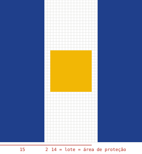

# Design system — Radar HIS (v1.0)

Base visual do produto, usada no site e no boletim por e-mail. Os tokens estão em [tokens.css](tokens.css) e o logo em [03_BRAND_IDENTITY/logo](../03_BRAND_IDENTITY/logo/).

> "Radar HIS" é o nome do produto. A marca-mãe (antes "BECO") continua em aberto. O símbolo foi desenhado para funcionar sozinho, sem depender do nome.

## Conceito

**H de quadra.** Duas quadras e, entre elas, o lote encontrado. A leitura é um H, de HIS e de habitação. A linguagem vem do cadastro da cidade (setor, quadra e lote) e da sinalização de rua de São Paulo: azul das placas e amarelo das faixas. Não usa casa, pin de mapa, gradiente nem ícone de IA.

- Grade 48 × 48. Quadras de 15 × 48, ruas de 2 e lote de 14 × 14 centralizado.
- **Área de proteção:** 1 lote (14/48 da altura do símbolo) em volta de toda a assinatura.
- **Tamanho mínimo:** 16 px de altura para o símbolo (use `favicon.svg`, sem as ruas em volta do lote) e 28 px para a assinatura horizontal.

## Arquivos do logo

| Arquivo | Uso |
|---|---|
| `assinatura-horizontal.svg` | Padrão, em fundo claro |
| `assinatura-horizontal-negativa.svg` | Fundo escuro ou foto |
| `assinatura-horizontal-mono.svg` | Impressão em uma cor, carimbo, documentos |
| `assinatura-horizontal-sem-tagline.svg` | Espaços pequenos (cabeçalho, e-mail) |
| `assinatura-vertical.svg` | Capas e telas quadradas |
| `simbolo.svg`, `simbolo-negativo.svg`, `simbolo-mono.svg` | Versão reduzida |
| `icone-app.svg` | Ícone de aplicativo e atalho na tela inicial |
| `favicon.svg` | Aba do navegador (16 a 32 px) |

O texto do logo está convertido em curvas e não depende de fonte instalada. Para regerar: `python3 03_BRAND_IDENTITY/gerar_identidade.py --fontes <pasta das fontes> --saida 03_BRAND_IDENTITY/logo`.

**Não fazer:** mudar as cores do símbolo; usar o amarelo como cor de texto em fundo claro; girar, distorcer ou pôr sombra; colocar o símbolo dentro de um pin, casa ou círculo; usar gradiente.

## Cores

| Token | Nome | HEX | RGB | CMYK (aprox.) | Uso | Contraste com texto |
|---|---|---|---|---|---|---|
| `--placa` | Placa | #1F3F8B | 31, 63, 139 | 78, 55, 0, 45 | Primária: símbolo, links, botão principal | 9,8:1 com branco |
| `--faixa` | Faixa | #F2B705 | 242, 183, 5 | 0, 24, 98, 5 | Destaque: lote, marcadores | 9,5:1 com Asfalto (só preenchimento) |
| `--asfalto` | Asfalto | #171C1B | 23, 28, 27 | 18, 0, 4, 89 | Texto principal | 17,2:1 com branco |
| `--grafite` | Grafite | #59625F | 89, 98, 95 | 9, 0, 3, 62 | Texto secundário | 6,3:1 com branco |
| `--meio-fio` | Meio-fio | #D6D9D3 | 214, 217, 211 | 1, 0, 3, 15 | Bordas | — |
| `--calcada` | Calçada | #E5E7E2 | 229, 231, 226 | 1, 0, 2, 9 | Chips, fundos de apoio | — |
| `--concreto` | Concreto | #EFF0EC | 239, 240, 236 | 0, 0, 2, 6 | Fundo da página | — |
| `--papel` | Papel | #FFFFFF | 255, 255, 255 | 0, 0, 0, 0 | Cartões e fichas | — |
| `--ganho` | Ganho | #1C6B45 | 28, 107, 69 | 74, 0, 36, 58 | Valorização acima da inflação | 6,5:1 com branco |
| `--atencao` | Atenção | #8A5A00 | 138, 90, 0 | 0, 35, 100, 46 | Ganho abaixo do CDI, avisos | 5,9:1 com branco |
| `--alerta` | Alerta | #B42318 | 180, 35, 24 | 0, 81, 87, 29 | Acima do teto, perda real | 6,6:1 com branco |

Todos os textos atendem WCAG AA (4,5:1). O CMYK é uma conversão matemática: para impressão, valide com prova de cor na gráfica. O tema escuro tem valores próprios em `tokens.css`.

## Tipografia

| Papel | Fonte | Pesos | Por quê |
|---|---|---|---|
| Marca e títulos | **Archivo** | 700, 800 | Grotesca de origem editorial, firme em tamanhos grandes, sem cara de "fonte de startup" |
| Interface e texto | **IBM Plex Sans** | 400, 500, 600 | Muito legível em celular, números claros |
| Dados e códigos | **IBM Plex Mono** | 400, 500 | Lembra documento de registro; alinha SQL, matrícula e datas |

As três têm licença OFL: uso comercial gratuito, inclusive em app e impressos. Escala: 34 / 24 / 19 / 16 / 14 / 13 px. Números em colunas usam `font-variant-numeric: tabular-nums`.

## Componentes

| Componente | Regra |
|---|---|
| **Cartão de imóvel** | Fundo Papel, borda Meio-fio, raio 14. Título em Archivo 600, linha de contexto em Grafite, etiquetas (chips) embaixo, chamada "Ver contatos →" em Placa |
| **Chip de estado** | Pílula. Ganho, Atenção e Alerta usam o par cor + fundo do token. Nunca só a cor: sempre com texto ("+5% acima da inflação", "acima do teto") |
| **Botão de ação** | Principal: fundo Placa, texto branco. Secundário: Papel com borda. Sempre com verbo e consequência ("Achar quem vende", "Mandar no WhatsApp") |
| **Marcador "lote"** | Quadrado Faixa de 8 a 12 px antes de títulos de seção. Repete o lote do símbolo e é o elemento gráfico próprio da marca |
| **Selo de procedência** | Texto em Plex Mono 13 px, cor Grafite, com a fonte e a data ("GeoSampa · 13/09/2026"). Aparece junto de todo número |
| **Mapa** | Distritos em Calçada com borda Meio-fio; pontos nas cores de categoria (HIS, HMP, mercado livre) |

## Voz

Direta, com número e com próximo passo. Diz o que sabe, diz o que não sabe e nunca promete o que o dado não mostra. Exemplo: "3 revendas novas em Itaquera. A melhor ganhou 12% acima da inflação. Toque para ver quem vende."
