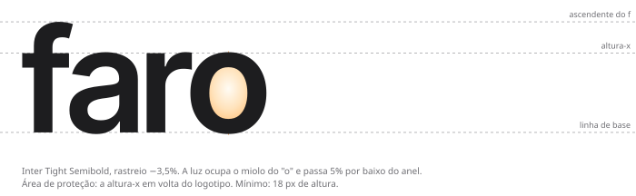

# Design system — Faro (v2.0)

Base visual do produto, usada no site e no boletim por e-mail. Os tokens estão em [tokens.css](tokens.css), o logo em [03_BRAND_IDENTITY/faro](../03_BRAND_IDENTITY/faro/) e o manual de marca em [03_BRAND_IDENTITY/manual](../03_BRAND_IDENTITY/manual/) (publicado em https://claude.ai/artifact/4GWnbgo3bev3XKnsu2kc6v).

## Origem

Vem da análise dos 24 projetos "real estate" do Behance ([benchmark visual](../01_RESEARCH_BENCHMARK/BENCHMARK_VISUAL_BEHANCE.md), 23/11/2026):

| Referência | O que trouxemos |
|---|---|
| [Astrix Builders](https://www.behance.net/gallery/226083297/Astrix-Builders-Construction-brand-identity) | Dupla azul-marinho e laranja; folha de construção do símbolo |
| [Alliance](https://www.behance.net/gallery/257399129/Alliance-Brand-Identity) | Números gigantes como peça gráfica (herói numérico, número do item) |
| [Lumen](https://www.behance.net/gallery/258362035/LUMEN-WEBSITE-BRANDING) | Rótulos editoriais com traço e uma família tipográfica principal |
| [Bilge İnşaat](https://www.behance.net/gallery/231472123/Bilge-nsaat-Modern-Real-Estate-Branding) | Área de proteção desenhada e apresentação técnica da marca |

Deixamos de fora o padrão dominante (preto, creme e dourado com serifa de luxo), foto de banco de imagem, casinha, telhado e pin de mapa, gradientes e mockups 3D.

## Símbolo

O F como farol: haste em Tinta, facho laranja separado por uma "rua" de 2 módulos, braço que fecha o F. Grade 48 × 48, proteção de 8 módulos, mínimo de 16 px (favicon) e 24 px (assinatura).

**Não fazer:** distorcer; trocar as cores da haste e do facho; colar o facho na haste; pôr o símbolo dentro de pin, casa ou círculo; usar gradiente ou sombra; usar o laranja Facho em texto pequeno sobre branco.

## Cores

| Token | Nome | HEX | RGB | CMYK (aprox.) | Uso | Contraste |
|---|---|---|---|---|---|---|
| `--tinta` | Tinta | #0F1E46 | 15, 30, 70 | 79, 57, 0, 73 | Texto, banda de marca, haste | 16,2:1 no branco |
| `--facho` | Facho | #FF5A1F | 255, 90, 31 | 0, 65, 88, 0 | Facho, botão principal, números grandes | 5,2:1 com Tinta; 3,1:1 no branco (só preenchimento e números grandes) |
| `--facho-escuro` | Facho escuro | #C2410C | 194, 65, 12 | 0, 66, 94, 24 | Laranja para texto e links | 5,2:1 no branco |
| `--nevoa` | Névoa | #D9E4F5 | 217, 228, 245 | 11, 7, 0, 4 | Superfícies de apoio | 12,6:1 com Tinta |
| `--gelo` | Gelo | #F5F7FB | 245, 247, 251 | 2, 2, 0, 2 | Fundo da página | 15,1:1 com Tinta |
| `--papel` | Papel | #FFFFFF | 255, 255, 255 | 0, 0, 0, 0 | Cartões e fichas | — |
| `--grafite` | Grafite | #4B5875 | 75, 88, 117 | 36, 25, 0, 54 | Texto secundário | 7,1:1 no branco |
| `--linha` | Linha | #D5DCE8 | 213, 220, 232 | 8, 5, 0, 9 | Bordas | — |
| `--ganho` | Ganho | #11795A | 17, 121, 90 | 86, 0, 26, 53 | Valorização acima da inflação | 5,4:1 no branco |
| `--atencao` | Atenção | #A15C00 | 161, 92, 0 | 0, 43, 100, 37 | Ganho abaixo do CDI, avisos | 5,2:1 no branco |
| `--alerta` | Alerta | #C0262D | 192, 38, 45 | 0, 80, 77, 25 | Acima do teto, perda real | 5,9:1 no branco |

Todo texto atende WCAG AA (4,5:1). O CMYK é conversão matemática: valide com prova de cor na gráfica. O tema escuro tem valores próprios em `tokens.css`.

## Tipografia

| Papel | Fonte | Pesos | Por quê |
|---|---|---|---|
| Marca, títulos e texto | **Schibsted Grotesk** | 400, 500, 700, 900 | Grotesca de jornal: firme no título, legível no celular, números fortes |
| Dados e rótulos | **JetBrains Mono** | 400, 500 | Lembra documento de registro; alinha SQL, matrícula e datas |

Licença OFL (uso comercial gratuito). Escala: herói 56 / 40 / 26 / 19 / 16 / 14 / 13 px. Números em colunas usam `tabular-nums`; números de herói usam `proportional-nums` para não abrir espaço no ponto do milhar.

## Componentes

| Componente | Regra |
|---|---|
| **Banda de marca** | Faixa Tinta no topo com a assinatura negativa e a data em JetBrains Mono; borda inferior Facho de 6 a 8 px |
| **Rótulo editorial** | JetBrains Mono 12 px, caixa-alta, espaçamento 0,14 em, Grafite: "— BOLETIM DE TERÇA-FEIRA, 24/11/2026" |
| **Título do boletim** | Schibsted Grotesk 900, 38 a 52 px, espaçamento −0,03 em: "O que rolou ontem" |
| **Herói numérico** | Três números do dia em Schibsted 900 laranja Facho, entre linha Tinta (2 px) e linha clara |
| **Seção numerada** | "01 — ALVARÁS NOVOS" com o número em Facho escuro e linha Tinta embaixo; a numeração segue a ordem de leitura |
| **Item do boletim** | Quadrado Facho de 9 px, endereço em 700, contexto em Grafite, "Ver contatos e detalhes →" em Facho escuro; à direita o número do item em 900 (verde se ganho, vermelho se alerta) |
| **Botão** | Principal: fundo Facho, texto Tinta. Secundário: fundo Tinta, texto branco. Sempre com verbo ("Achar quem vende") |
| **Chip de estado** | Pílula com o par cor + fundo do token e sempre com texto ("+8% acima da inflação", "acima do teto") |
| **Selo de procedência** | JetBrains Mono 11 a 13 px com fonte e data de cada dado |

**E-mail:** tabelas com estilos inline, 600 px, sem imagens (o logo é desenhado com células e bordas), para funcionar no Gmail e no Outlook com imagens bloqueadas.

## Voz

Direta, com número e com próximo passo. Diz o que sabe, diz o que não sabe e não promete o que o dado não mostra. Exemplo: "3 revendas novas em Itaquera. A melhor ganhou 12% acima da inflação. Toque para ver quem vende."
