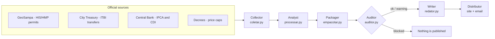

<p align="center"><a href="README.md">Português</a> · <b>English</b></p>

# Faro: real-estate intelligence from open data

Faro turns scattered public real-estate records into organized, traceable information. Its first focus is social housing in the city of São Paulo: **HIS** (*Habitação de Interesse Social*) and **HMP** (*Habitação de Mercado Popular*), housing categories with legal price caps and buyer-income rules.

> **Personal project, early stage.** The data pipeline and the daily bulletin run every day. Brand, product and data architecture are being developed phase by phase (see [status](#status)). Faro replaces the working names "BECO" and "Radar HIS"; trademark and domain checks are still pending.

## Problem

São Paulo publishes the pieces separately. Building permits for HIS and HMP are in one city map layer. Property-transfer tax (ITBI) records, with value, date and unit, are in another dataset. The price caps are in decrees. Nobody links them, so it is hard to answer simple questions: which buildings were approved as social housing, how many units were sold, at what price, and whether any sale went above the legal cap.

## How it works

Faro uses only official sources and links them by address and tax-lot keys. Each step is a deterministic Python script. An LLM agent orchestrates the routine every morning, decides whether to publish based on the Auditor's verdict, and distributes the result. It never produces the numbers.



**Linking a permit to its sales.**

1. Each lot with an HIS/HMP permit gets keys: fiscal sector and block (the first six digits of the tax-lot number), postal code and street number.
2. Every ITBI record with the same key is attached to the building.
3. A record counts as a **unit** when its complement names an apartment or tower, and as a **lot** otherwise or when the value is above R$ 2 million.
4. Records for the same unit within 90 days count as one deal; records below 30% of the building's typical value are treated as complementary.
5. The first sale is separated from resales; payment in kind and swaps are kept apart.
6. "Above the cap" is flagged only in buildings that are 100% HIS/HMP, for sales from 28 May 2025 onward.

The **Auditor** compares counts and dates with the previous run and can block publication. The **Writer** builds one piece of content ("what we mapped yesterday") that becomes both the email and the bulletin section of the site.

## Data sources

| Source | What it provides | Refresh |
|---|---|---|
| GeoSampa, "HIS e HMP – Alvará de Execução" layer | HIS-1, HIS-2 and HMP permits since Aug 2019: address, tax-lot number, units per category | Irregular |
| São Paulo City Treasury, paid ITBI records | Sales since 2006: value, date, unit, registry office. **No buyer or seller names** | Monthly |
| Central Bank of Brazil (SGS 433 and 4391) | Monthly IPCA and CDI | Monthly |
| Municipal decrees 64.244/2025 and 64.895/2026 | Sale-price caps per category | Yearly |

## Getting started

```bash
cd 11_APPLICATION/radar_his
pip install python-calamine shapely
python3 coletar.py --dados _dados        # downloads the sources (~550 MB of ITBI the first time)
python3 processar.py --dados _dados      # builds site/dados/*.json (~1 min)
cd site && python3 -m http.server        # opens the report at http://localhost:8000
```

`python3 rotina_diaria.py` runs the full daily routine. The network must allow `wms.geosampa.prefeitura.sp.gov.br`, `prefeitura.sp.gov.br`, `drive.prefeitura.sp.gov.br` and `api.bcb.gov.br`. Details, in Portuguese, are in [`11_APPLICATION/radar_his/`](11_APPLICATION/radar_his/).

## Repository structure

The repository is organized by project phase, from research to deployment. Each folder has a README with its phase and status.

| Folder | Content |
|---|---|
| [`00_PROJECT_MANAGEMENT`](00_PROJECT_MANAGEMENT/) | Decision log (ADR style), changelog, pending decisions |
| [`01_RESEARCH_BENCHMARK`](01_RESEARCH_BENCHMARK/) | Phase 0 report, competitor profiles, sources consulted |
| [`02_BRAND_STRATEGY`](02_BRAND_STRATEGY/) · [`03_BRAND_IDENTITY`](03_BRAND_IDENTITY/) · [`04_DESIGN_SYSTEM`](04_DESIGN_SYSTEM/) | Positioning, identity, brand manual and tokens |
| [`06_REAL_ESTATE_INTELLIGENCE`](06_REAL_ESTATE_INTELLIGENCE/) · [`07_HIS_HMP_LEGAL`](07_HIS_HMP_LEGAL/) | Data-source map and a versioned record of HIS/HMP regulations |
| [`11_APPLICATION/radar_his`](11_APPLICATION/radar_his/) | The code: collection, analysis, audit, bulletin and site |
| `05`, `08`–`10`, `12`–`15` | Placeholders for the phases that have not started |

## Status

| Phase | Status |
|---|---|
| 0 · Research, benchmark and diagnosis | Delivered for validation |
| 1 · Brand strategy | Waiting for Phase 0 approval |
| 4 · Real-estate intelligence | Preliminary research done |
| 6 · AI agents and skills | Preliminary proposal |
| 2, 3, 5, 7–10 | Not started |

## Limitations

- Open data has no owner names or phone numbers.
- The city layer starts in 2019, so older HIS buildings do not appear on the map.
- The ITBI value is the one declared by the taxpayer.
- A unit whose complement was written differently over time may not be recognized as the same unit, which undercounts resales.

## Working rules

No phase is skipped. Irreversible decisions (name, identity, data architecture, paid integrations) need explicit approval. No data is invented: facts have a source, hypotheses are marked as such, and demo data, when used, is labeled and never mixed with verified data.
